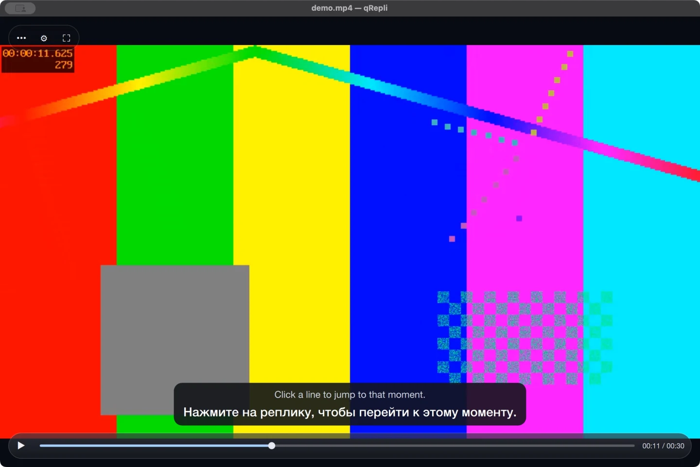
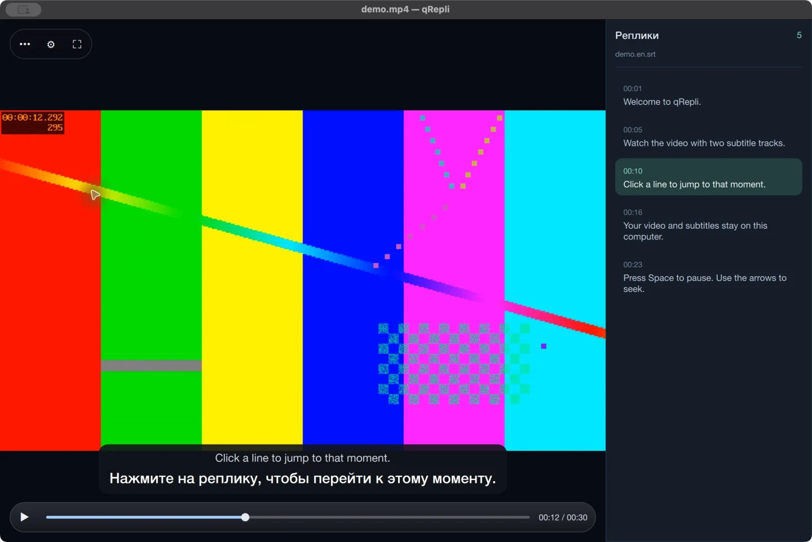

# qRepli

**English** | [Русский](README.ru.md)

A desktop video player built with **C++20, Qt Quick and Qt Multimedia**, with local English speech recognition powered by **whisper.cpp**.


**Current status:** local video playback, English transcription and two SRT tracks. **Local English-to-Russian translation is available through Ollama**. Russian cues are displayed with their original timestamps; existing SRT files can also be loaded.

## Screenshots

**Playback with two subtitle tracks**



**Transcript panel**



## Features

- Open local videos using a file dialog, drag and drop, or the command line.
- Play, pause, seek, adjust volume, enter fullscreen and select an audio track when multiple tracks are available.
- Load original and translated SRT tracks independently; toggle each track on screen.
- Browse a transcript with active-line highlighting and click a line to seek to it.
- Read UTF-8 SRT files, including BOM, CRLF, multiline and overlapping cues. Basic HTML formatting is converted to plain text.
- Transcribe English speech locally from the current position and prepare subtitles ahead of playback.
- Pause playback while the required interval is being processed; preserve a manual pause when results arrive.
- Select a Whisper model, FFmpeg executable and GPU/CPU mode. Apple Silicon can use Metal.
- Export available original subtitles, including generated transcripts, to SRT.
- Report playback, subtitle and transcription errors. Invalid SRT input does not replace a loaded track.

Runtime processing does not upload video, audio or text. Subtitles remain in memory until exported. Volume, model/FFmpeg paths and the GPU preference are saved in application settings.

## Requirements and platform status

| Dependency | Requirement |
| --- | --- |
| Compiler | C++20 support and a C compiler for native dependencies |
| CMake | 3.25+ for the supplied presets; 3.24+ for manual configuration |
| Qt | 6.8+ with Quick, QuickControls2, Multimedia, Network and LinguistTools; Test when tests are enabled |
| Build tool | Make, Ninja or a suitable platform generator |
| FFmpeg | A separate executable for speech recognition |
| Whisper model | Local `ggml-base.en.bin`, approximately 148 MB |

The presets use schema version 6, which requires CMake 3.25+. See the [CMake presets documentation](https://cmake.org/cmake/help/latest/manual/cmake-presets.7.html).

Development builds have been verified on macOS ARM64 with AppleClang 17 and Qt 6.11.2 from Homebrew. Windows and Linux use portable code paths but have **not been build/run verified**. Standalone distribution packages have not been validated on clean machines.

The first ASR-enabled CMake configuration downloads pinned whisper.cpp v1.9.5 from GitHub and verifies its SHA-256. Model downloads are separate. Once dependencies and the model are installed, runtime operation is offline.

## Build

Run commands from the project root.

```sh
cmake --preset dev
cmake --build --preset dev --parallel
ctest --preset dev
```

The `dev` preset builds into `build/`, uses `RelWithDebInfo` and enables tests. If Qt is not found, set the path to your Qt kit during configuration:

```sh
cmake --preset dev -DCMAKE_PREFIX_PATH=/path/to/Qt/kit
```

### macOS

Install Xcode Command Line Tools with `xcode-select --install`. If using Homebrew:

```sh
brew install cmake qt qttools ffmpeg
cmake --preset dev -DCMAKE_PREFIX_PATH="$(brew --prefix qt)"
cmake --build --preset dev --parallel
ctest --preset dev
```

### Windows and Linux

On Windows, install a Qt 6.8+ desktop kit with the required modules, its matching compiler (for example MSVC), CMake and FFmpeg. Run commands in the selected compiler environment. On Linux, install a C++20-capable GCC/Clang toolchain, CMake, Make or Ninja, Qt 6.8+ and FFmpeg. Distribution Qt packages may be older than the required version. Set `CMAKE_PREFIX_PATH` to the selected kit.

For multi-configuration generators such as Visual Studio, Xcode or Ninja Multi-Config:

```sh
cmake --build --preset dev --config RelWithDebInfo --parallel
ctest --preset dev -C RelWithDebInfo
```

These platform instructions are starting points; Windows and Linux remain unverified.

### Manual configuration and Qt Creator

To avoid presets, use a separate build directory:

```sh
cmake -S . -B build-manual -DCMAKE_BUILD_TYPE=RelWithDebInfo -DBUILD_TESTING=ON
cmake --build build-manual --config RelWithDebInfo --parallel
ctest --test-dir build-manual -C RelWithDebInfo --output-on-failure
```

Add `-DCMAKE_PREFIX_PATH=/path/to/Qt/kit` if needed. Configure with `-DQREPLI_WHISPER=OFF` for playback and SRT support without ASR, or `-DBUILD_TESTING=OFF` to omit tests. An ASR-disabled build does not need the ASR model or external FFmpeg executable; Qt's media backend still has its own dependencies.

In Qt Creator, open `CMakeLists.txt`, select a Qt 6.8+ desktop kit and run the `qRepli` target.

## Run

On macOS:

```sh
open build/qRepli.app
```

Open a video with original and translated subtitles:

```sh
./build/qRepli.app/Contents/MacOS/qRepli \
  /absolute/path/video.mp4 \
  --subtitles /absolute/path/video.en.srt \
  --translation /absolute/path/video.ru.srt
```

On Linux, the usual single-configuration executable is `build/qRepli`. On Windows, the path depends on the generator, for example `build/RelWithDebInfo/qRepli.exe`. Multi-configuration generators may also add a configuration directory on other platforms.

| Argument | Purpose |
| --- | --- |
| `video` | Optional local video path |
| `--subtitles file` | Original SRT track |
| `--translation file` | Existing translated SRT track |
| `--model file` | Local Whisper model |
| `--ffmpeg file` | FFmpeg executable path |
| `--transcribe` | Request transcription once video duration becomes available |
| `--help`, `--version` | Print help or version |

CLI model and FFmpeg paths are also saved in application settings.

## Local speech recognition

Download the English `base.en` model with checksum verification:

```sh
cmake -P cmake/DownloadWhisperModel.cmake
```

The model is saved to `models/ggml-base.en.bin`; the directory is excluded from Git. Re-running the script verifies an existing file.

1. Open a video with an English audio track.
2. Open speech settings and choose `ggml-base.en.bin`. FFmpeg is usually detected automatically; select its executable if necessary.
3. Start speech recognition. Playback waits for the first required interval; a manual pause remains in effect.
4. Export the generated original subtitles using the SRT save action.

Or start from the command line:

```sh
./build/qRepli.app/Contents/MacOS/qRepli /absolute/path/video.mp4 \
  --model models/ggml-base.en.bin --transcribe
```

### Current limitations

- English speech recognition and Russian translation. A local Ollama server and a downloaded translation model are required for automatic translation.
- Audio is extracted in windows of up to 20 seconds as mono 16 kHz float PCM. The next window starts only when its beginning is at most 30 seconds ahead of playback, allowing approximately 50 seconds of prepared audio coverage.
- Basic silence and no-speech filtering is implemented. Full VAD, overlapping windows and cross-window phrase repair are not implemented; music and noise can produce incorrect text.
- Seeking outside the prepared interval clears the generated track and restarts near the new position. There is no persistent transcript cache. Export includes only text already prepared.
- Whisper timestamps may be inaccurate. Unusual containers, shifted audio and track matching between Qt and FFmpeg need broader validation.
- Initial Metal shader preparation can take longer. Performance has been checked on short synthetic samples, not full-length movies.

## Automatic Russian subtitles

Install [Ollama](https://ollama.com/download), then start its local server. On macOS with Homebrew:

```sh
brew install ollama
OLLAMA_NO_CLOUD=1 ollama serve
```

In a second terminal, download the default model once (about 1.9 GB):

```sh
ollama pull qwen2.5:3b
```

Keep Ollama running. Open speech settings in qRepli, enable **“Переводить на русский во время просмотра”** (enabled by default), and choose **“Файл” → “Распознать и перевести”**. The translation model name can be changed in those settings. The application contacts only `127.0.0.1:11434`, with proxies and redirects disabled. Use a local model and run Ollama with `OLLAMA_NO_CLOUD=1` to disable its cloud functionality.

Each audio window is recognized and translated before playback is released. If processing falls behind, the video pauses until Russian subtitles are ready. Manual pause remains respected. Seeking outside the prepared range cancels old work and clears generated English and Russian tracks. Loading a translated SRT during automatic translation stops the active pipeline, preventing generated results from overwriting it.

This is incremental processing of local files, not zero-latency live streaming: windows are up to 20 seconds and model speed determines preparation time. Translation errors are shown explicitly and pause playback; disable automatic translation and restart recognition to continue with English only. Export currently saves the original track.

Details and validation: [local translation](docs/TRANSLATION.md).

## Controls

| Action | Shortcut |
| --- | --- |
| Open video | Cmd+O on macOS / Ctrl+O on Windows and Linux |
| Play / pause | Space |
| Seek backward / forward 5 seconds | Left / Right arrow |
| Fullscreen | F11 or double-click the video |
| Leave fullscreen | Esc |

Use the **File** menu (••• over the video in the upper-left corner) to load SRT tracks, open the transcript, or start recognition. The gear opens settings for subtitle visibility, audio and speech. Dropping an SRT loads the original track. SRT files must be UTF-8 and no larger than 8 MB.

## Installation and deployment

No ready-made installers or automated standalone packaging are provided. The following preparation steps have not been verified on clean target machines. Use deployment tools from the same Qt kit and architecture used for compilation.

### Install the build

```sh
cmake --install build --config RelWithDebInfo --prefix dist
```

This installs `dist/qRepli.app` on macOS, `dist/bin/qRepli.exe` on Windows, or `dist/bin/qRepli` on Linux. The current install target installs the application but does **not** automatically collect Qt dependencies, the external FFmpeg executable or the model.

### macOS

After installation, run your Qt kit's deployment tool:

```sh
/path/to/Qt/kit/bin/macdeployqt dist/qRepli.app -qmldir=qml
open dist/qRepli.app
```

The tool collects Qt libraries, plugins and QML dependencies. Validate the resulting bundle without the development SDK. Signing and notarization are not configured in this project. [Qt macOS deployment](https://doc.qt.io/qt-6/macos-deployment.html).

### Windows

In PowerShell with the Qt/MSVC environment configured:

```powershell
& "C:/Qt/6.x/msvc2022_64/bin/windeployqt.exe" --release --qmldir qml dist/bin/qRepli.exe
```

Replace the kit path. Distribute the entire prepared directory, not just the EXE. MSVC distributions should include installation of the official Visual C++ Redistributable. [Qt Windows deployment](https://doc.qt.io/qt-6/windows-deployment.html).

### Linux

For a local installation, provide compatible Qt libraries, QML modules and platform/multimedia plugins on the target system, then run `dist/bin/qRepli`. A single executable is not a portable package. Standalone distribution needs separate packaging and library/plugin search-path configuration. AppImage, DEB and RPM configurations are not included. [Qt Linux deployment](https://doc.qt.io/qt-6/linux-deployment.html).

### Model and FFmpeg on the target machine

1. Install FFmpeg for the target OS and architecture. ASR requires an external executable independently of any FFmpeg libraries used by Qt Multimedia.
2. Copy the verified `ggml-base.en.bin` model or download it using the script from the source tree.
3. Select the model's absolute path and, if needed, FFmpeg's path in speech settings. Automatic discovery depends on the working directory and PATH, so explicitly select paths after moving the application.
4. Check playback, audio, transcription and SRT export on a short English video. Repeat with networking disabled to verify offline operation.

Include the relevant dependency licenses when distributing binaries: [THIRD_PARTY_NOTICES.md](THIRD_PARTY_NOTICES.md).

Supported media formats depend on Qt's media backend and codecs. The development macOS environment used the `darwin` backend. ASR reads audio through its separate FFmpeg process and does not require Qt's FFmpeg backend.

## Testing

The standard CTest suites cover subtitles, the player and transcription infrastructure. Real-model tests are separate so regular tests do not require a 148 MB model. Prepare a short English clip containing the word “video” at the path used below:

```sh
QREPLI_TEST_MODEL="$PWD/models/ggml-base.en.bin" \
QREPLI_TEST_AUDIO="$PWD/build/speech-demo.mp4" \
./build/test_transcription realModelSmokeTest

QREPLI_TEST_MODEL="$PWD/models/ggml-base.en.bin" \
QREPLI_TEST_AUDIO="$PWD/build/speech-demo.mp4" \
./build/test_player realTranscriptionAndSourceChange
```

These examples use POSIX shell syntax. The media file is a local test artifact, not a bundled sample. Adjust executable paths for multi-configuration builds. See [QA notes](docs/QA.md) for the longer scenario.

For a reproducible playback/SRT demo, create a test-pattern video with a quiet tone:

```sh
ffmpeg -hide_banner -loglevel error -y \
  -f lavfi -i 'testsrc2=size=960x540:rate=24' \
  -f lavfi -i 'sine=frequency=440:sample_rate=48000' \
  -t 30 -c:v libx264 -preset ultrafast -crf 28 \
  -c:a aac -af 'volume=0.03' -movflags +faststart build/demo.mp4

./build/qRepli.app/Contents/MacOS/qRepli build/demo.mp4 \
  --subtitles tests/fixtures/demo.en.srt \
  --translation tests/fixtures/demo.ru.srt
```

This checks manually prepared subtitle timing and playback, not speech recognition.

## Troubleshooting

| Problem | Check |
| --- | --- |
| CMake cannot find Qt | Qt version, installed modules and the selected kit's `CMAKE_PREFIX_PATH` |
| Preset parsing fails | Use CMake 3.25+ or configure manually without presets |
| FFmpeg not found | Install the executable and select its full path in speech settings |
| Model does not load | Select `ggml-base.en.bin`; re-run the download script to verify SHA-256 |
| Playback fails after deployment | Qt plugins, media backend and available codecs |
| GPU problems | Disable GPU in speech settings and restart transcription |
| No Russian text | Enable Russian translation in speech settings, start Ollama and download the selected model; then restart recognition |

## Source layout and further reading

- `src/playercontroller.*`: playback coordination, subtitle tracks and error handling.
- `src/transcription.*`: background Whisper, look-ahead limits, cancellation and stale-result filtering.
- `src/audioextractor.*`: PCM extraction via FFmpeg without a shell or temporary WAV files.
- `src/subtitles.*`: SRT parsing/export and subtitle timeline lookup.
- `src/subtitlemodel.*`: transcript list model.
- `qml/`: user interface and video output.
- `tests/`: automated checks and SRT fixtures.

[Implementation plan](PLAN.md), [program logic and editable Excalidraw diagrams](docs/PROGRAM_LOGIC.md), [LLPlayer review](docs/LLPLAYER_REVIEW.md) and [QA notes](docs/QA.md) are currently in Russian. The next development stage is improved speech segmentation and translation quality. Older architecture diagrams describe the previous implementation; see [the current translation pipeline](docs/TRANSLATION.md).
